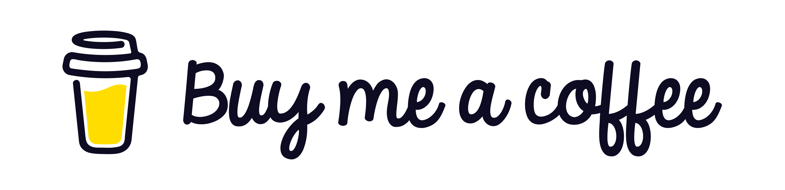

# aricma-todo

`aricma-todo` is a set of user interfaces over one todo format: a TUI, a command line,
standalone apps, a web app — as many shells as it takes to work with your todos
anywhere, rather than inside an ecosystem that owns them and hands back only the export
it feels like. The format is
[OPS](https://github.com/aricma/open-productivity-standard), and it is the point: every
interface reads and writes the same documents, so a todo can move from one app to
another, and the data stays yours. An app is a shell that views and transforms data,
nothing more.

This repository starts with the terminal client, `lazytodo`, because it is the one we
wanted first and the one we use. A web app was begun before it and is still in the
pipeline, and `lib/` and `cli/` are in the tree, unfinished. What comes next is open.

The rest of this page is about `lazytodo`.

## lazytodo


`lazytodo` is a todo client as a terminal UI, inspired by `lazygit`. It reads the todos
in markdown files and in comments inside source code. We do have a slight bias towards
`TODOs.md` files, so if you want the best support at this early stage, start there.

We add features and fix bugs as they come in, and we are still in a pre-1.0 phase of
development.

### Install

You can look at the GitHub releases, or use our install script, which does little more
than download the binary you need and store it in `~/.local/bin` — or wherever you
want. We do not touch your `PATH`.

```sh
curl -fsSL https://aricma.app/install.sh | sh -s -- --bin lazytodo
curl -fsSL https://aricma.app/install.sh | sh -s -- --bin lazytodo --version 0.1.0
curl -fsSL https://aricma.app/install.sh | sh -s -- --bin lazytodo --version 0.1.0 --install-dir $HOME/stuff-I-added-to-the-PATH
```

The middle line pins a release instead of taking the latest, and the last one says where
the binary goes.

### Use

The tool is simple: not much to configure yet. Point it at a folder or a file and we see
whether we can read your todos — then you manage them.

```sh
lazytodo .                   # the TUI for the current directory
lazytodo path/to/TODOs.md    # ... or this one
```

- `?` for the whole key map: every binding, grouped by the panel it works in, with the
  panel you are in first. It is drawn from the same table as the line of keys at the
  bottom of the screen, so a key cannot be on that page and missing from the bar.
- Move between the panels: `tab` and `shift+tab` walk the sections, `→` steps into a
  view and `←` brings you back, and `0`–`3` jump straight to the panel whose title
  carries that number.

### Read

- [tui/README.md](./tui/README.md) — the index: the manual, the RFCs, the glossary,
  the changelog.
- [tui/docs/manual.md](./tui/docs/manual.md) — the closest we have come to real
  documentation for this TUI.
- [tui/docs/rfc/](./tui/docs/rfc/README.md) — the decisions we made building it, one
  per RFC.

If something is wrong or missing, open an issue
[here](https://github.com/aricma/todo/issues).

## What else is in the tree

| part | what it is | state |
| --- | --- | --- |
| `lib/` | the markdown todo rules: parse, edit, check, format, OPS export | the core `lazytodo` is drawn over, not released |
| `cli/` | `aricma-todo` — check, format, export, import; no screen | written, not released |
| `testkit/` | what the suites share: run a binary, read what it said, drive a use case | a dev-dependency |
| `use-cases/` | the use cases as data, one folder per case | how the suites are driven |

A clone builds and tests with `cargo test`; the toolchain is pinned in
`rust-toolchain.toml`, and `mask` actions are in [maskfile.md](./maskfile.md).

## Support

If this app is fun for you and you want to see the web app happen, you can support us
here:

<a href="https://www.buymeacoffee.com/aricma"></a>

<a href="https://ko-fi.com/N2N426RWKU"></a>

Tell us what you want next: the web app or the cli. For now we keep going with the TUI,
`lazytodo`. Cheers.

## License

MIT — see [LICENSE](./LICENSE).

The browser app this library once grew out of is not part of this repository.
